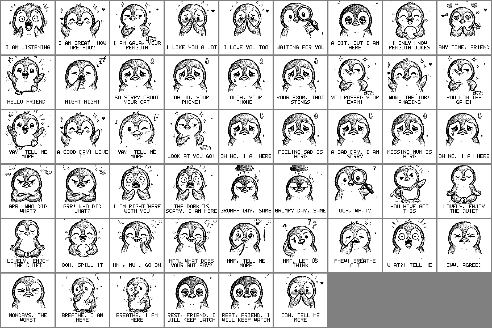

# Gawa, the desk pet that listens

## The problem, in one line

**There is no low effort way to be heard for ten seconds without being managed, judged or ignored.**

Texting a friend means waiting and feeling like a bother. A journal feels like homework.
A phone assistant hands you a list of tasks. So the feeling stays unsaid, and small things pile up.

## What Gawa is

Gawa is a tiny penguin that lives on your desk. You talk to it out loud. It listens, makes a face,
and says something kind. It never gives advice, never nags, never needs an app or a login.
It runs on a small board with a microphone and a black and white screen, with no internet at all.

## How you talk to it

1. Say **"Hey Gawa"**. Its ears go up.
2. Say your thing. "I passed my driving test." "My cat is sick." "I am so tired."
3. It makes a face and answers. "YOU PASSED YOUR DRIVING TEST!" "SO SORRY ABOUT YOUR CAT." "REST, FRIEND."
4. Keep talking. For ten seconds after every answer it keeps listening (a little "(((" mark shows).
5. Say "thank you", "okay stop", "that is all" or "good night" to finish. Or just go quiet.

It understands 387 sentences built from 55 patterns, and it has 22 moods drawn by hand.
You can also ask it things: "how are you?", "what is your name?", "do you like me?", "tell me a joke".

## What is in this folder

| Folder | What is inside | Who it is for |
|---|---|---|
| `docs/` | The brief, the build diary (`BUILD-LOG.md`), the test sheet, how to use GitHub | Everyone. Start with the build diary. |
| `releases/` | Ready made files to load onto the board. Use the newest one. | People who want to run Gawa. |
| `firmware/Gawa/` | The program itself (Arduino). `phrases.h` is what it understands, `faces.h` is how it draws. | People who want to change Gawa. |
| `artwork/` | The 24 penguin drawings, the original sheets, and preview pictures | Anyone who wants to draw a new face. |
| `tools/` | `make_sketches.py` turns drawings into something the board can show | People who add drawings. |
| `extras/` | A parked "cloud brain" version that talks to the internet. Not used right now. | Later. |

## Load Gawa onto the board (2 minutes, no software to install)

1. Unplug the board. Hold the **gear** button, plug the cable in, let go.
2. In Chrome open https://espressif.github.io/esptool-js/ → **Connect** → pick the "USB JTAG" port.
3. Click **Erase Flash**, wait for "completed".
4. Flash Address: **0x0**. Choose File → `releases/` → the newest `Gawa_v…_full_8MB.bin`.
5. Click **Program**. Wait for 100% and "Hash of data verified".
6. Unplug, plug back in. It says "SAY HEY GAWA".

## Change what it understands (Arduino IDE)

Open `firmware/Gawa/Gawa.ino`. Board **ESP32S3 Dev Module**, USB CDC On Boot Enabled, Flash 8MB, Flash Mode QIO,
PSRAM OPI, Partition Scheme **Custom**, Erase All Flash **Disabled**. Upload.

- New sentences: add a word to a list in `phrases.h`. One word teaches a whole family of sentences.
- New faces: put a PNG in `artwork/sketches/`, run `python3 tools/make_sketches.py`, upload.
- Timings (listening window, rest time): the `#define` lines at the top of `Gawa.ino`.

## The board

Waveshare ESP32-S3-ePaper-1.54 (V2): a 1.54 inch e-paper screen (200 x 200 dots), a microphone, a small speaker,
two buttons, 8 MB of storage. The speech recognition is Espressif's ESP-SR and runs on the chip.
